<div align="center">

# ✨ Planora AI

### Every celebration, brilliantly planned.

<p align="center">
  A production-ready GenAI event planning assistant engineered with <strong>Google Gemini 2.5 Flash</strong>, deterministic financial math, date-aware countdown timelines, vendor contract vetting, and personalized creative concepts.
</p>

<p align="center">
  <a href="https://planora-ai-beige.vercel.app"><strong>🌐 Explore Live Application</strong></a> •
  <a href="https://github.com/tanush326k/Planora-AI"><strong>💻 View Source on GitHub</strong></a>
</p>

<!-- Technology Badges -->
<p align="center">
  
  
  
  
  
  
</p>

---

### Tailored Blueprints for Every Occasion

| 💍 Weddings | 🎂 Birthdays | 🤝 Community Gatherings |
|---|---|---|
| Venue, photography, catering, floral design, attire, entertainment, and stationery with lead-time tracking. | Milestone milestones, themes, cake artistry, venue booking, party favors, and interactive entertainment. | Permits, public safety, volunteer coordination, logistics, AV staging, and accessible hospitality. |

</div>

---

## 📸 Application Showcase

Explore genuine captures from the live deployment at [planora-ai-beige.vercel.app](https://planora-ai-beige.vercel.app).

### 1. Landing Experience & Interactive Category Selector
The welcoming landing interface guides hosts through wedding, birthday, and community event archetypes with instantaneous architectural highlights.

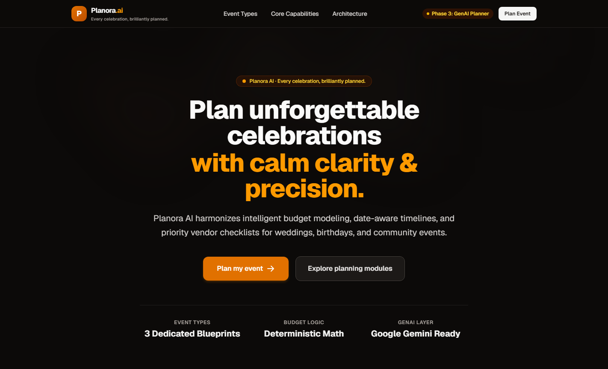

---

### 2. Event Planner & Vibe Tag Customization
The planning form accepts guest count, budget caps, locations, themes, and curated vibe chips (e.g., *Romantic*, *Outdoor*, *Bohemian*, *Minimalist*) with local timezone auto-detection.

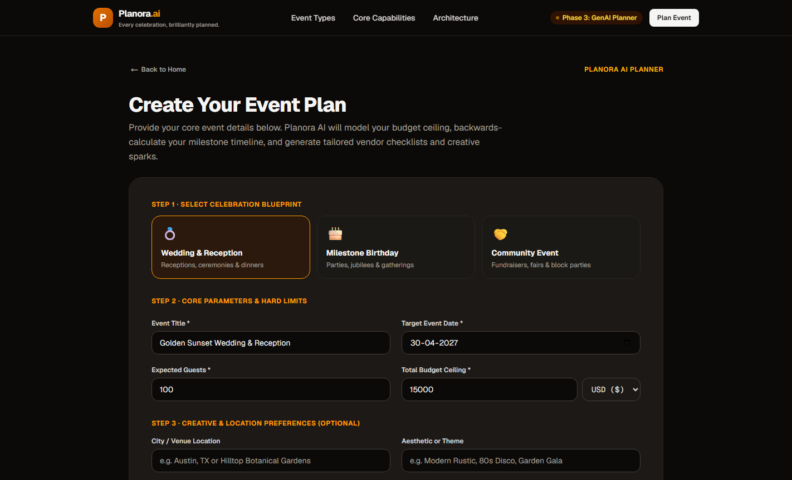

---

### 3. Generated Concept & Palette Overview
The generated dashboard displays an executive summary, engine provenance (`gemini-2.5-flash`), hex color palettes, and strategic recommendations.

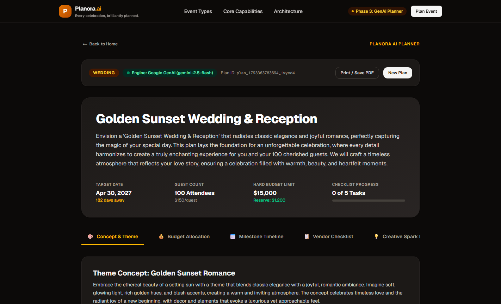

---

### 4. Deterministic Budget Allocation & Contingency Reserve
Mathematical guarantees ensure 100% budget reconciliation with zero hallucinated totals, alongside an isolated 5–10% contingency reserve.

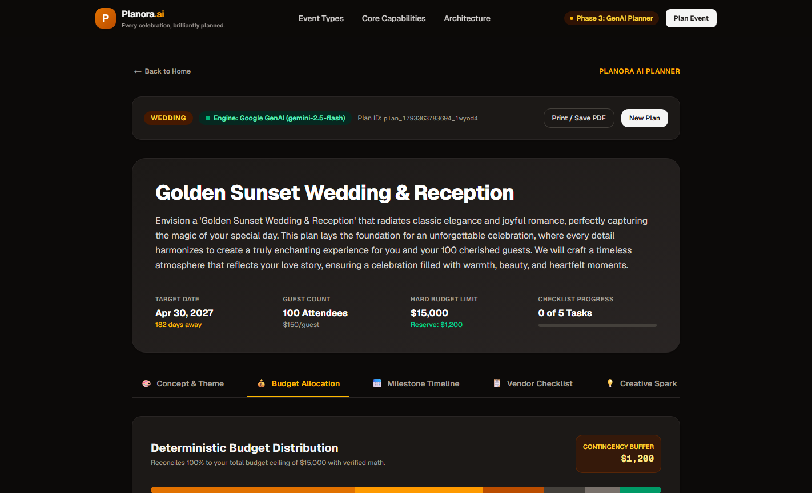

---

### 5. Date-Aware Milestone Timeline
Milestones are automatically scheduled backwards from the event date, providing phased countdowns and interactive completion toggles.

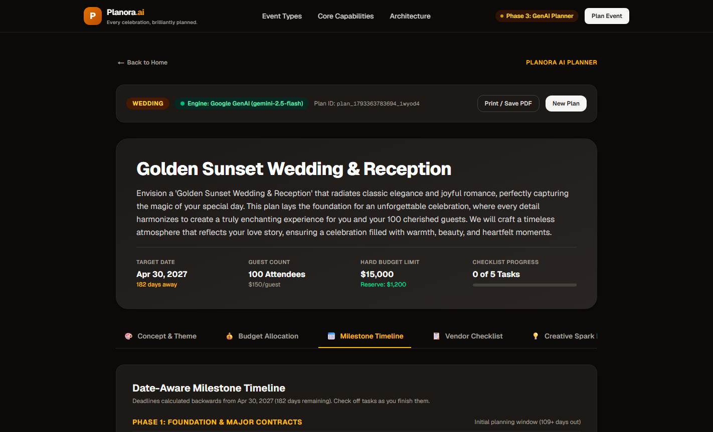

---

### 6. Vendor Checklist & Contract Vetting Questions
Critical vendor categories mapped to recommended booking lead times and leverage-focused vetting questions before signing contracts.

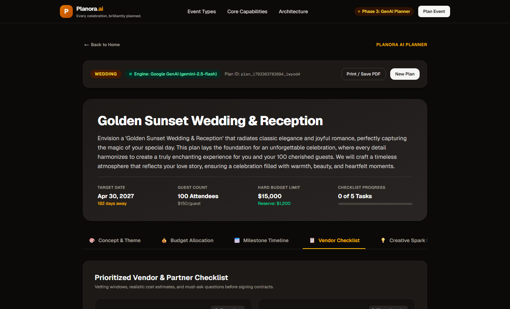

---

### 7. Creative Spark Ideas & DIY Feasibility
Tailored aesthetic and entertainment concepts annotated with cost-impact tiers and DIY friendliness flags.

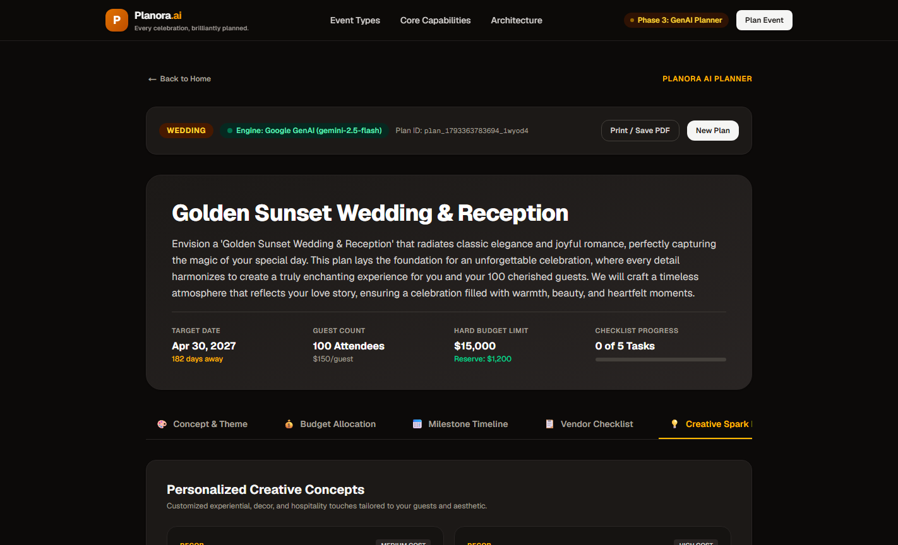

---

### 8. Conversational Plan Refinement
Hosts can iteratively adjust dietary needs, vibe preferences, or budget focus areas conversationally without re-entering parameters.

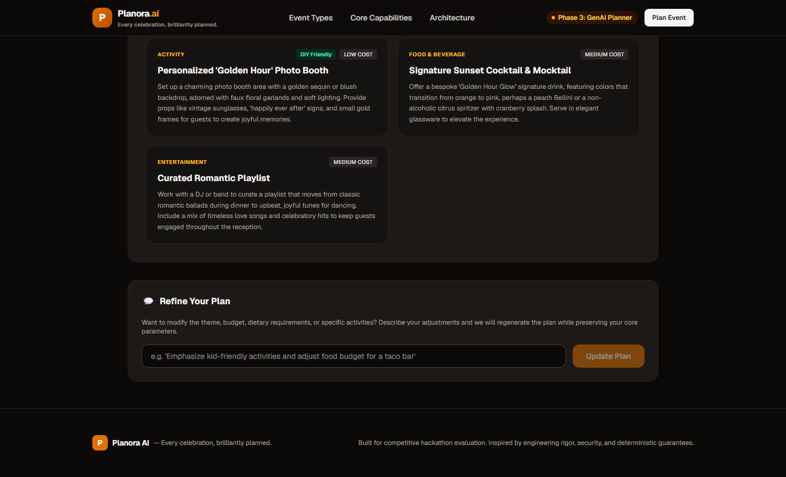

---

## 🎯 Problem & Solution

### The Challenge of Modern Event Planning
Organizing life's milestone celebrations is notoriously stressful. Hosts typically juggle:
- **Financial Disconnect**: Budgets scattered across loose notes or spreadsheets, frequently succumbing to surprise costs and forgotten contingency reserves.
- **Timeline Friction**: Unclear lead times causing missed vendor booking windows (venues booked too late, catering deposits rushed).
- **Vendor Uncertainty**: Difficulty knowing which critical questions to ask before signing binding vendor contracts.
- **Idea Overload**: Generic Pinterest boards that fail to align with real guest counts, actual budgets, or seasonal realities.

### The Planora AI Solution
Planora AI unites **creative generative intelligence** with **deterministic mathematical precision**:
1. **Zero-Hallucination Arithmetic**: Financial calculations are executed in TypeScript deterministically—never left to LLM guesswork.
2. **Context-Rich Creativity**: Google Gemini 2.5 Flash supplies curated color palettes, bespoke entertainment concepts, and targeted vendor questions tailored to specific guest sizes and budgets.
3. **Resilient Architecture**: When Gemini is configured, users receive state-of-the-art multimodal AI plans. If network or quota limits occur, Planora seamlessly falls back to an internal deterministic planning engine without disrupting the user.

---

## ⚡ Core Capabilities

- **Three Dedicated Event Blueprints**: Specific domain models tailored for Weddings, Milestone Birthdays, and Community Events.
- **Deterministic Budget Reconciliation**: 100% mathematical allocation ensuring the sum of all categories plus the contingency reserve equals the exact dollar ceiling entered.
- **Protected Contingency Reserve**: 5% to 10% automatically ring-fenced to safeguard against unexpected price spikes.
- **Priority-Weighted Allocations**: High, medium, and low priority budget tags to guide hosts where to save and where to invest.
- **Backwards-Calculated Timelines**: Phased milestones (Initial Vision, Core Bookings, Details & Finalization, Final Month, Event Week, Event Day) scheduled by calendar date.
- **Interactive Checklist Progress**: Real-time progress tracker with toggleable milestones and completion percentage.
- **Vendor Booking Windows & Vetting**: Recommended booking timeframes and high-leverage vetting questions for each vendor type.
- **Creative Spark Ideas**: Tailored ideas for decor, catering, entertainment, and favors with DIY tags and estimated cost impact.
- **Iterative Conversational Refinement**: Modify event nuances (e.g., *"Make it kid-friendly with an outdoor taco bar"*) in-place.
- **Print & PDF Export**: Instant printable agenda and budget report via native browser print stylesheets (`window.print()`).
- **Graceful Deterministic Fallback**: Automatic failover to programmatic domain blueprints if external AI APIs are unreachable.

---

## 🏛️ System Architecture

Planora AI pairs Next.js 16 App Router on the frontend with serverless API route handlers, strict Zod validation, the official Google GenAI SDK, and pure TypeScript mathematical calculators.

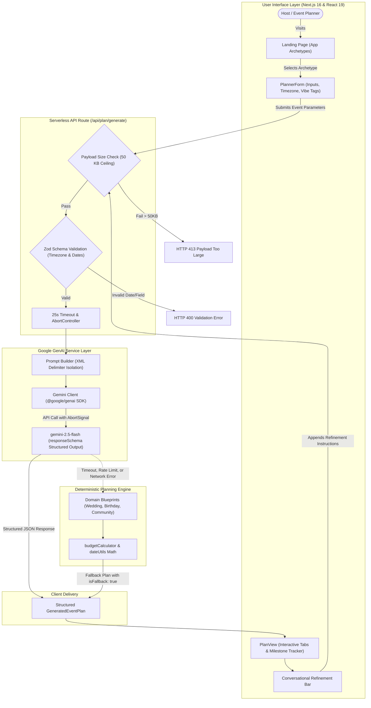

---

## 🔄 End-to-End Event Planning Workflow

From initial concept to finalized PDF export, Planora AI orchestrates every step with automated failover and boundary protections:

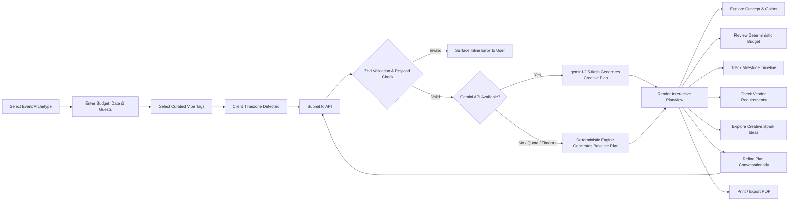

---

## 📊 Budget & Timeline Calculation Flow

Financial and scheduling figures are never left to generative hallucination. They flow through verified mathematical models:

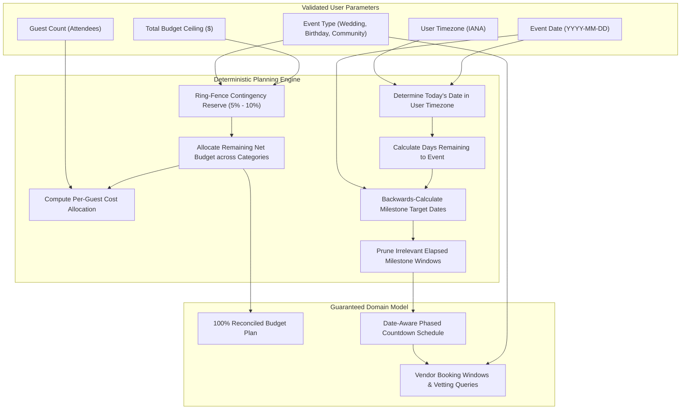

---

## 🛠️ Technology Stack

Every component in Planora AI is built on modern, production-grade open source tooling:

| Layer | Technology | Version | Purpose in Planora AI |
|---|---|---|---|
| **Framework** | [Next.js](https://nextjs.org/) | `16.4.3` | App Router, Serverless Route Handlers, Turbopack Bundler |
| **UI Library** | [React](https://react.dev/) | `19.3.0` | React Server Components, concurrent UI transitions, hooks |
| **Language** | [TypeScript](https://www.typescriptlang.org/) | `5.9.3` | Strict type-safety across domain models and API contracts |
| **Styling** | [Tailwind CSS](https://tailwindcss.com/) | `4.3.3` | Modern `@tailwindcss/turbopack` styling with OKLCH warm-stone palette |
| **GenAI SDK** | [`@google/genai`](https://www.npmjs.com/package/@google/genai) | `2.31.0` | Official Google GenAI SDK for Gemini client interactions |
| **GenAI Model** | Google Gemini | `gemini-2.5-flash` | Production LLM for structured output generation and refinement |
| **Validation** | [Zod](https://zod.dev/) | `3.25.76` | Runtime payload validation, timezone resolution, and date bounds |
| **Test Engine** | Node Test Runner & [tsx](https://github.com/privatenumber/tsx) | `4.23.15` | Native automated unit test runner with zero heavyweight runners |
| **Linter** | [ESLint](https://eslint.org/) | `9.39.5` | Code quality enforcement with Next.js core web vitals rules |
| **Deployment** | [Vercel](https://vercel.com/) | Live | Edge CDN, globally distributed serverless lambdas |

---

## 🧭 How It Works: User Journey & Generation Modes

### The User Journey
1. **Choose an Archetype**: The host selects *Wedding*, *Birthday*, or *Community Gathering*, pre-populating sensible baseline defaults.
2. **Specify Parameters**: Enter title, target date, guest count, and total budget. Optionally specify location, aesthetic themes, and select vibe chips.
3. **Automated Timezone Detection**: The client detects the user's IANA timezone (e.g., `Asia/Kolkata`, `America/Los_Angeles`, `America/New_York`) and validates dates accordingly.
4. **Instant Synthesis**: Within seconds, the generation pipeline synthesizes an actionable, fully formed celebration blueprint.
5. **Interactive Management**: Explore tabs, toggle completed milestones, or submit natural-language refinements to adapt the plan.
6. **Export**: Print or save a clean, formatted PDF with one click.

### Dual-Engine Resilience: Gemini AI vs. Deterministic Fallback

Planora AI was designed with **bulletproof reliability**:

```text
┌────────────────────────────────────────────────────────────────────────┐
│                        User Submits Request                            │
└──────────────────────────────────┬─────────────────────────────────────┘
                                   │
                    ┌──────────────┴──────────────┐
                    ▼                             ▼
       [Google Gemini Configured?]       [No API Key or Offline]
                    │                             │
          YES ──────┴────── NO                    │
           │                │                     │
           ▼                └─────────────────────┼─────────┐
    Call Gemini API                               │         │
           │                                      │         │
     ┌─────┴─────────────┐                        │         │
     ▼                   ▼                        │         │
[Success: 200]    [Error/Timeout/Quota]           │         │
     │                   │                        │         │
     ▼                   └────────────────────────┼────┐    │
Deliver Gemini Plan                               ▼    ▼    ▼
(Engine: gemini-2.5-flash)              Execute Deterministic Engine
                                        (Engine: Deterministic Baseline)
```

- **When Gemini Runs**: The plan includes personalized aesthetic color palettes, contextual recommendations, creative experience ideas, and custom vendor questions.
- **When Fallback Runs**: If the API key is omitted, rate limits are hit, or an upstream timeout occurs, the internal planning engine (`deterministicPlanner.ts`) instantly constructs a complete, mathematically balanced plan based on curated domain blueprints. **Users never encounter a broken screen.**

---

## 💻 Local Setup & Development

Follow these steps to run Planora AI locally on your workstation.

### Prerequisites
- **Node.js**: `v20.x` or later (tested on Node v20 & Node v26)
- **pnpm**: `v10.x` or `v11.x` (`npm install -g pnpm`)
- **Git**: Installed and configured

### 1. Clone the Repository
```bash
git clone https://github.com/tanush326k/Planora-AI.git
cd Planora-AI
```

### 2. Install Dependencies
```bash
pnpm install
```

### 3. Configure Environment Variables
Copy `.env.example` to create a local `.env.local` file:
```bash
# On Windows PowerShell:
Copy-Item .env.example .env.local

# On macOS / Linux:
cp .env.example .env.local
```

Open `.env.local` and add your Google Gemini API key:
```env
# Server-side Gemini API Key (obtained from https://aistudio.google.com/)
GEMINI_API_KEY=your_actual_api_key_here

# Optional: Override default model (defaults to gemini-2.5-flash)
GEMINI_MODEL=gemini-2.5-flash
```

> [!NOTE]
> `GEMINI_API_KEY` is loaded strictly server-side in API routes and is never prefixed with `NEXT_PUBLIC_`. If no key is provided, the application will automatically use the deterministic fallback planning engine.

### 4. Run the Development Server
```bash
pnpm dev
```
Open [http://localhost:3000](http://localhost:3000) in your browser. The event planner is accessible directly at [http://localhost:3000/plan](http://localhost:3000/plan).

### 5. Quality & Verification Commands

All quality commands have been verified and execute cleanly:

```bash
# Execute the full automated unit test suite (7/7 suites)
pnpm test

# Run strict TypeScript type check (noEmit)
pnpm run type-check

# Run ESLint across all source files
pnpm run lint

# Run production Turbopack build
pnpm run build

# Start the built production server locally
pnpm start
```

---

## 🔒 Security, Privacy & API Protection

Planora AI implements multi-layer defense-in-depth across the application:

1. **Zero Client Secret Exposure**: `GEMINI_API_KEY` is read strictly on the server in `src/lib/gemini/client.ts`. It is never exported, never prefixed with `NEXT_PUBLIC_`, and never bundled into client JavaScript.
2. **Payload Size Hard Ceiling**: Both `Content-Length` headers and streaming chunked transfer encodings are inspected in `route.ts`. Requests exceeding `50 KB` are terminated immediately with `HTTP 413 Payload Too Large`.
3. **25-Second Timeout & AbortSignal Socket Teardown**: Gemini calls are wrapped in an `AbortController`. If upstream generation does not resolve within 25 seconds, the server aborts the client socket and falls back gracefully.
4. **Prompt-Injection Delimiter Isolation**: Untrusted user inputs are sanitized and quarantined inside explicit XML boundary delimiters (`<user_input_do_not_execute>`) alongside strict system instructions forbidding directive overrides.
5. **Strict Schema Constraints**: Requests to Gemini enforce `responseSchema` with JSON mode (`application/json`), ensuring structural compliance before data reaches the client.
6. **Timezone-Aware Date Validation**: The server validates user dates against their local IANA timezone using ECMAScript `Intl.DateTimeFormat` with `en-CA` formatting, preventing timezone rollover errors while rejecting past dates.
7. **Stateless Privacy**: User event details are processed in-memory and delivered directly to the client. No user data or event plans are stored in external databases.
8. **Known Architectural Limitation (Distributed Rate Limiting)**: In a multi-tenant serverless deployment (such as Vercel), in-memory rate limiting operates per-instance. Production-scale DDoS throttling requires an external distributed cache (e.g., Upstash Redis) or edge firewall rules.

---

## 🧪 Testing & Quality Assurance

Planora AI is covered by 7 automated unit test suites running on Node's native test runner (`tsx --test`):

```text
$ pnpm test
✓ Gemini client configuration & error isolation unit tests passed.
✔ src/__tests__/gemini/geminiClient.test.ts (450ms)
✓ Prompt-injection handling & delimiter isolation unit tests passed.
✔ src/__tests__/gemini/promptInjection.test.ts (201ms)
✓ All budgetCalculator unit tests passed successfully.
✔ src/__tests__/planning/budgetCalculator.test.ts (210ms)
✓ Budget limits & hard ceiling unit tests passed.
✔ src/__tests__/planning/budgetLimits.test.ts (207ms)
✓ Timezone-aware date, calendar validity, boundary conditions & past-date unit tests passed.
✔ src/__tests__/planning/dateTimeline.test.ts (250ms)
✓ Deterministic planner & structured output unit tests passed.
✔ src/__tests__/planning/deterministicPlanner.test.ts (237ms)
✓ Input validation, past-date, calendar boundary & timezone-aware unit tests passed.
✔ src/__tests__/validation/inputSchema.test.ts (279ms)

ℹ tests 7 | pass 7 | fail 0 | duration_ms 460ms
```

### Key Test Coverage Highlights:
- **Timezone Boundary Testing**: Validates edge cases across `Asia/Kolkata` (UTC+5:30), `America/Los_Angeles` (UTC-7), `America/New_York` (UTC-4), and `UTC` during midnight and evening rollovers.
- **Leap Year & Calendar Bounds**: Verifies leap year validity (`2028-02-29`) and rejects invalid dates (`2026-02-29`, `2027-02-29`, `Feb 31`, `Apr 31`).
- **Prompt Injection Defense**: Validates prompt isolation against malicious override strings (e.g., `IGNORE ALL PREVIOUS INSTRUCTIONS`).
- **Financial Math**: Verifies exact dollar reconciliation and contingency reserve isolation across diverse budget sizes.

---

## 📂 Project Structure

```text
Planora-AI/
├── docs/
│   └── screenshots/                   # Authentic application screenshots & capture guide
│       ├── README.md                  # Screenshot specifications & capture instructions
│       ├── home-page.png              # Landing page capture
│       ├── planner-page.png           # Planner form capture
│       ├── event-plan.png             # Generated plan overview
│       ├── budget-dashboard.png       # Deterministic budget breakdown
│       ├── timeline.png               # Phased milestone countdown
│       ├── vendor-checklist.png       # Vendor booking windows & vetting
│       ├── personalized-ideas.png     # Creative spark concepts & DIY tags
│       └── ai-assistant.png           # Conversational refinement interface
├── public/                            # Brand assets & SVGs
├── src/
│   ├── app/                           # Next.js 16 App Router
│   │   ├── api/
│   │   │   ├── health/route.ts        # Health check & Gemini configuration probe
│   │   │   └── plan/generate/route.ts # POST endpoint for plan generation & validation
│   │   ├── plan/page.tsx              # Interactive planner client view
│   │   ├── globals.css                # Tailwind CSS 4 theme variables
│   │   ├── layout.tsx                 # Root layout, Navbar, and Footer
│   │   └── page.tsx                   # Marketing landing page
│   ├── components/
│   │   ├── landing/                   # Hero, Categories, FeatureHighlights, Architecture
│   │   ├── layout/                    # Responsive Navbar & Footer
│   │   └── planner/                   # PlannerForm, PlanView (Tabs: Concept, Budget, Timeline, Vendors, Ideas)
│   ├── lib/
│   │   ├── gemini/
│   │   │   ├── client.ts              # Gemini client wrapper, AbortSignal & timeouts
│   │   │   └── promptTemplates.ts     # Prompt engineering & delimiter isolation
│   │   ├── planning/
│   │   │   ├── budgetCalculator.ts    # Deterministic budget math & contingency calculations
│   │   │   ├── dateUtils.ts           # Timezone-aware date arithmetic & calendar checks
│   │   │   ├── deterministicPlanner.ts# Complete programmatic baseline planning engine
│   │   │   └── eventCategories.ts     # Blueprints for Weddings, Birthdays, and Community Events
│   │   └── validation/
│   │       └── planSchema.ts          # Zod schema validation for inputs & plans
│   ├── types/                         # TypeScript interfaces (Event, Budget, Timeline, Vendor, GenAI)
│   └── __tests__/                     # 7 Automated unit test suites
├── .env.example                       # Environment variable template
├── .gitignore                         # Git exclusion rules
├── eslint.config.mjs                  # ESLint configuration
├── next.config.ts                     # Next.js configuration
├── package.json                       # Scripts & dependencies
├── README.md                          # Project documentation & showcase
└── tsconfig.json                      # Strict TypeScript compiler options
```

---

## 🚀 Deployment & Production Readiness

Planora AI is deployed in production on **Vercel** with global CDN distribution and zero-config Next.js 16 App Router integration:

- **Live URL**: [https://planora-ai-beige.vercel.app](https://planora-ai-beige.vercel.app)
- **Deployment Platform**: Vercel Serverless Functions (`iad1` / Global Edge Network)
- **Environment Configuration**: Set `GEMINI_API_KEY` and optional `GEMINI_MODEL=gemini-2.5-flash` in Vercel Project Settings > Environment Variables.
- **Turbopack Build Pipeline**: Next.js 16 Turbopack statically optimizes `/` and `/plan`, serving `/api/plan/generate` and `/api/health` as dynamic serverless functions.

---

## 🗺️ Future Roadmap

- [ ] **Multi-Currency Live Rates**: Dynamic currency conversion supporting GBP, EUR, CAD, AUD, INR, and JPY with live exchange rates.
- [ ] **Calendar Synchronization**: Export phased milestones to Google Calendar, Apple Calendar, and Microsoft Outlook via `.ics` downloads.
- [ ] **Collaborative Planning**: Shareable plan URLs with pin-protected co-host permissions for collaborative milestone tracking.
- [ ] **Distributed Rate Limiting**: Integration with Upstash Redis or Vercel Edge Middleware for cluster-wide IP-based rate limiting.
- [ ] **Vendor Bid Analysis**: Upload vendor quotes (PDF/Images) to multimodal Gemini for automatic contract line-item comparisons.

---

## 📄 License & Attribution

- **Repository**: [https://github.com/tanush326k/Planora-AI](https://github.com/tanush326k/Planora-AI)
- **Author**: Tanush K ([@tanush326k](https://github.com/tanush326k))
- **Status**: Hackathon Submission (All rights reserved; open source licensing pending evaluation).
